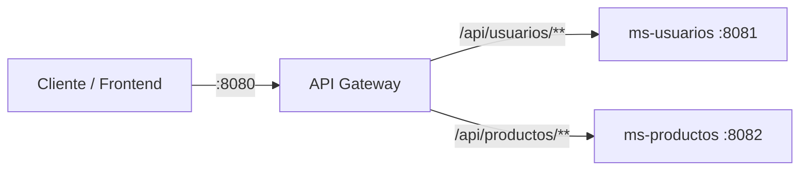

# 🚪 Microservicios Demo – API Gateway con Spring Cloud Gateway

Proyecto de ejemplo que muestra, desde cero, cómo funciona un **API Gateway** en una arquitectura de microservicios usando **Spring Boot** y **Spring Cloud Gateway**.

El objetivo es entender la base: cómo un único punto de entrada recibe todas las peticiones y las redirige al microservicio correcto.

---

## 📌 ¿Qué es un API Gateway?

Un API Gateway es el **único punto de entrada** a un sistema de microservicios. Funciona como la **recepción de un edificio**: el cliente no necesita saber en qué "oficina" (servicio) está cada cosa; llega a recepción y ella lo dirige al lugar correcto.

El gateway **no muestra** los servicios en otro puerto: **recibe la petición, la reenvía al microservicio que corresponde y devuelve la respuesta** al cliente.

```
Cliente ──► Gateway (8080) ──► ms-usuarios (8081)
Cliente ◄── Gateway (8080) ◄── ms-usuarios (8081)
```

---

## 🏗️ Arquitectura



| Servicio       | Puerto | Responsabilidad                              |
|----------------|--------|----------------------------------------------|
| `api-gateway`  | 8080   | Punto de entrada único, enruta las peticiones |
| `ms-usuarios`  | 8081   | Expone la lista de usuarios                  |
| `ms-productos` | 8082   | Expone la lista de productos                 |

---

## 🛠️ Tecnologías

- **Java 17**
- **Spring Boot 4**
- **Spring Cloud 2025.1.x**
- **Spring Cloud Gateway** (versión reactiva, sobre WebFlux y Netty)
- **Spring Web** (en los microservicios)
- **Maven**

---

## 📁 Estructura del proyecto

```
microservicios-demo/
├── api-gateway/      # Gateway: recibe todo y enruta
├── ms-usuarios/      # Microservicio de usuarios
└── ms-productos/     # Microservicio de productos
```

Cada carpeta es un proyecto Spring Boot independiente, con su propio `pom.xml`.

---

## ⚙️ Configuración del Gateway

Toda la lógica de enrutamiento está en `api-gateway/src/main/resources/application.yaml`:

```yaml
server:
  port: 8080

spring:
  application:
    name: api-gateway
  cloud:
    gateway:
      server:
        webflux:
          routes:
            - id: usuarios
              uri: http://localhost:8081
              predicates:
                - Path=/api/usuarios/**

            - id: productos
              uri: http://localhost:8082
              predicates:
                - Path=/api/productos/**
```

Cómo se lee cada ruta:

- **`id`**: nombre identificador de la ruta.
- **`uri`**: a dónde se reenvía la petición.
- **`predicates`**: la condición que debe cumplir la petición. Por ejemplo: *"si la URL empieza con `/api/usuarios`, mándala al puerto 8081"*.

> 💡 En Spring Boot 4 / Spring Cloud 2025 las rutas usan el prefijo `spring.cloud.gateway.server.webflux.routes`. En versiones anteriores era `spring.cloud.gateway.routes`.

---

## ▶️ Cómo ejecutarlo

### Requisitos
- Java 17 o superior
- Maven (o usar el wrapper `mvnw` incluido en cada proyecto)

### Pasos

Levanta los tres proyectos, cada uno en su propia terminal:

```bash
# Terminal 1
cd ms-usuarios
./mvnw spring-boot:run

# Terminal 2
cd ms-productos
./mvnw spring-boot:run

# Terminal 3
cd api-gateway
./mvnw spring-boot:run
```

> En Windows usa `mvnw.cmd spring-boot:run`. También puedes ejecutarlos desde IntelliJ con el botón ▶ de cada clase `Application`.

---

## 🧪 Probar

Todas las llamadas se hacen **al gateway (puerto 8080)**:

| Petición                                  | Respuesta esperada                  | Atiende        |
|-------------------------------------------|-------------------------------------|----------------|
| `GET http://localhost:8080/api/usuarios`  | `["Juan","Pedro","María"]`          | ms-usuarios    |
| `GET http://localhost:8080/api/productos` | `["Notebook","Mouse","Teclado"]`    | ms-productos   |

Con `curl`:

```bash
curl http://localhost:8080/api/usuarios
curl http://localhost:8080/api/productos
```

El cliente **nunca llama directamente** a los puertos 8081 ni 8082.

---

## 🌐 ¿Por qué sirve un API Gateway? (cómo funciona en producción)

En local todo está abierto, por eso parece que el gateway "no aporta" mucho: puedes entrar directo al 8081 y saltártelo.

En un **deploy real** eso no es posible. Los microservicios viven en una **red privada**, sin acceso desde internet, y **solo el gateway está expuesto**:

```
           INTERNET                  │        RED PRIVADA (no accesible)
                                     │
Cliente ──► api.miempresa.cl ──► GATEWAY ──► ms-usuarios
            (único punto público)    │   └──► ms-productos
```

Si alguien intenta entrar directo a un microservicio, no puede: no tiene IP pública. **La única puerta es el gateway**, y por eso actúa como guardia.

### Lo que se centraliza en el gateway

1. **Seguridad:** valida el token (JWT) una sola vez. Si no es válido, responde `401` y la petición nunca llega al microservicio.
2. **Enrutamiento:** el frontend conoce una sola URL, sin saber cuántos servicios hay ni dónde están.
3. **Balanceo de carga:** reparte las peticiones entre varias instancias de un mismo servicio.
4. **CORS:** se configura una sola vez para el frontend.
5. **Rate limiting:** limita cuántas peticiones puede hacer un cliente, para frenar abusos.
6. **Circuit breaker:** si un servicio se cae, responde de forma controlada en vez de dejar al cliente esperando.
7. **Logs y monitoreo:** todo el tráfico pasa por un solo lugar.

### Cómo cambia la configuración al desplegar

- **Docker Compose:** solo se publica el puerto del gateway; los servicios se llaman por el nombre del contenedor:
  ```yaml
  uri: http://ms-usuarios:8081
  ```
- **Eureka (Service Discovery):** el gateway encuentra los servicios por nombre, aunque cambien de IP o haya varias instancias:
  ```yaml
  uri: lb://ms-usuarios
  ```
- **Kubernetes:** los servicios quedan internos y solo el gateway (o un Ingress) se expone a internet.

---

## 🚀 Próximos pasos

- [ ] Filtro global de seguridad en el gateway (validar header `Authorization`)
- [ ] Validación de JWT
- [ ] Service Discovery con Eureka (`lb://`)
- [ ] Configuración de CORS para un frontend Angular
- [ ] Circuit breaker y rate limiting con Resilience4j
- [ ] Docker Compose para levantar todo con un solo comando

---

## 👤 Autor

**Juan Carlos Inostroza Chávez**
Desarrollador Backend Java | Spring Boot | Microservicios

- GitHub: [@juankarlitos](https://github.com/juankarlitos)
- LinkedIn: [juan-carlos-inostroza-chavez](https://www.linkedin.com/in/juan-carlos-inostroza-chavez-247454192)
- YouTube: Backend al Hueso
