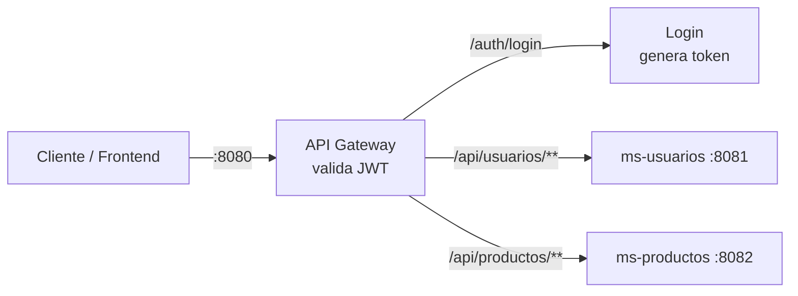
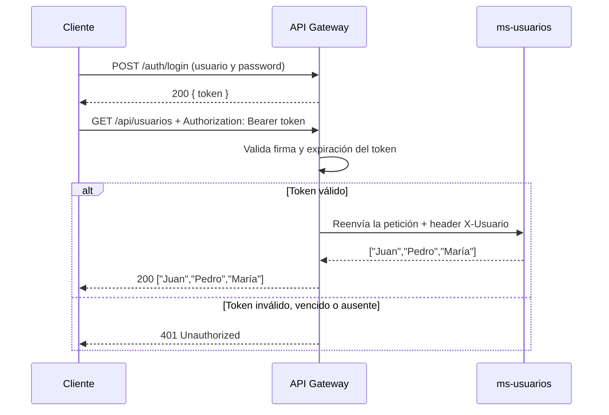

# 🚪 Microservicios Demo – API Gateway con Spring Cloud Gateway y JWT

Proyecto de ejemplo que muestra, desde cero, cómo funciona un **API Gateway** en una arquitectura de microservicios usando **Spring Boot** y **Spring Cloud Gateway**, con **autenticación centralizada mediante JWT**.

El objetivo es entender la base: cómo un único punto de entrada recibe todas las peticiones, decide si las deja pasar y las redirige al microservicio correcto.

---

## 📌 ¿Qué es un API Gateway?

Un API Gateway es el **único punto de entrada** a un sistema de microservicios. Funciona como la **recepción de un edificio**: el cliente no necesita saber en qué "oficina" (servicio) está cada cosa; llega a recepción y ella lo dirige al lugar correcto.

El gateway **no muestra** los servicios en otro puerto: **recibe la petición, la reenvía al microservicio que corresponde y devuelve la respuesta** al cliente.

```
Cliente ──► Gateway (8080) ──► ms-usuarios (8081)
Cliente ◄── Gateway (8080) ◄── ms-usuarios (8081)
```

---

## 🏗️ Arquitectura



| Servicio       | Puerto | Responsabilidad                                         |
|----------------|--------|---------------------------------------------------------|
| `api-gateway`  | 8080   | Punto de entrada único: login, validación JWT y enrutamiento |
| `ms-usuarios`  | 8081   | Expone la lista de usuarios                             |
| `ms-productos` | 8082   | Expone la lista de productos                            |

---

## 🛠️ Tecnologías

- **Java 17**
- **Spring Boot 4**
- **Spring Cloud 2025.1.x**
- **Spring Cloud Gateway** (versión reactiva, sobre WebFlux y Netty)
- **JJWT 0.12.6** (generación y validación de tokens JWT)
- **Spring Web** (en los microservicios)
- **Maven**

---

## 📁 Estructura del proyecto

```
microservicios-demo/
├── api-gateway/
│   └── src/main/java/cl/inostratech/gateway/
│       ├── ApiGatewayApplication.java
│       ├── AuthController.java   # POST /auth/login → entrega el token
│       ├── AuthFilter.java       # Filtro global: valida el token en cada petición
│       └── JwtUtil.java          # Genera y valida tokens JWT
├── ms-usuarios/                  # Microservicio de usuarios
└── ms-productos/                 # Microservicio de productos
```

Cada carpeta es un proyecto Spring Boot independiente, con su propio `pom.xml`.

---

## ⚙️ Configuración del Gateway

Toda la configuración está en `api-gateway/src/main/resources/application.yaml`:

```yaml
server:
  port: 8080

spring:
  application:
    name: api-gateway
  cloud:
    gateway:
      server:
        webflux:
          routes:
            - id: usuarios
              uri: http://localhost:8081
              predicates:
                - Path=/api/usuarios/**

            - id: productos
              uri: http://localhost:8082
              predicates:
                - Path=/api/productos/**

jwt:
  secret: mi-clave-super-secreta-para-el-gateway-de-inostratech-2026
```

Cómo se lee cada ruta:

- **`id`**: nombre identificador de la ruta.
- **`uri`**: a dónde se reenvía la petición.
- **`predicates`**: la condición que debe cumplir la petición. Por ejemplo: *"si la URL empieza con `/api/usuarios`, mándala al puerto 8081"*.

**`jwt.secret`** es la clave con la que se firman y validan los tokens. Debe tener al menos 32 caracteres (exigencia del algoritmo HS256).

> ⚠️ En un proyecto real la clave **nunca** va escrita en el código: se pasa como variable de entorno, por ejemplo `secret: ${JWT_SECRET}`.

> 💡 En Spring Boot 4 / Spring Cloud 2025 las rutas usan el prefijo `spring.cloud.gateway.server.webflux.routes`. En versiones anteriores era `spring.cloud.gateway.routes`.

---

## 🔐 Autenticación con JWT

### Flujo completo



1. El cliente hace **login** en `/auth/login` y recibe un **token firmado**.
2. En cada petición envía el token en el header `Authorization: Bearer <token>`.
3. El **gateway valida** la firma y la expiración del token.
4. Si es válido, reenvía la petición al microservicio y le agrega el header **`X-Usuario`** con el nombre del usuario.
5. Si no es válido, responde **401** y la petición **nunca llega** al microservicio.

### Las piezas

**`JwtUtil`** – genera y valida tokens:

```java
@Component
public class JwtUtil {

    private static final long EXPIRACION_MS = 60 * 60 * 1000; // 1 hora

    private final SecretKey key;

    public JwtUtil(@Value("${jwt.secret}") String secret) {
        this.key = Keys.hmacShaKeyFor(secret.getBytes(StandardCharsets.UTF_8));
    }

    public String generarToken(String usuario) {
        return Jwts.builder()
                .subject(usuario)
                .issuedAt(new Date())
                .expiration(new Date(System.currentTimeMillis() + EXPIRACION_MS))
                .signWith(key)
                .compact();
    }

    public Claims validarToken(String token) {
        return Jwts.parser()
                .verifyWith(key)
                .build()
                .parseSignedClaims(token)
                .getPayload();
    }
}
```

- **`generarToken`**: crea un token con el usuario (`subject`), fecha de creación y expiración de 1 hora, firmado con la clave.
- **`validarToken`**: verifica firma y expiración. Si el token fue modificado o venció, lanza una excepción.

**`AuthController`** – endpoint de login (público):

```java
@PostMapping("/login")
public ResponseEntity<Map<String, String>> login(@RequestBody LoginRequest request) {
    if ("admin".equals(request.usuario()) && "1234".equals(request.password())) {
        String token = jwtUtil.generarToken(request.usuario());
        return ResponseEntity.ok(Map.of("token", token));
    }
    return ResponseEntity.status(HttpStatus.UNAUTHORIZED)
            .body(Map.of("error", "Usuario o contraseña incorrectos"));
}
```

> En un proyecto real el login vive en un **microservicio de autenticación** que valida contra la base de datos. Aquí está en el gateway para mantener el ejemplo simple.

**`AuthFilter`** – filtro global que protege todas las rutas:

```java
@Override
public Mono<Void> filter(ServerWebExchange exchange, GatewayFilterChain chain) {
    String path = exchange.getRequest().getURI().getPath();

    // 1. El login es público
    if (path.startsWith("/auth/")) {
        return chain.filter(exchange);
    }

    // 2. Debe traer "Authorization: Bearer <token>"
    String authHeader = exchange.getRequest().getHeaders().getFirst("Authorization");
    if (authHeader == null || !authHeader.startsWith("Bearer ")) {
        return rechazar(exchange);
    }

    // 3. Validar firma y expiración
    String token = authHeader.substring(7);
    try {
        Claims claims = jwtUtil.validarToken(token);
        String usuario = claims.getSubject();

        // 4. Pasar el usuario al microservicio
        ServerWebExchange exchangeConUsuario = exchange.mutate()
                .request(r -> r.header("X-Usuario", usuario))
                .build();

        return chain.filter(exchangeConUsuario);
    } catch (JwtException e) {
        return rechazar(exchange);
    }
}
```

- **`GlobalFilter`**: se aplica a todas las rutas del gateway.
- **`chain.filter(exchange)`**: deja pasar la petición al microservicio.
- **`rechazar(...)`**: responde `401` y corta la petición.
- **`getOrder() = -1`**: el filtro se ejecuta antes que los demás.

> 💡 En Spring Boot 4 (Spring Framework 7) `HttpHeaders` ya no tiene `containsKey`; se usa `containsHeader` o `getFirst`.

---

## ▶️ Cómo ejecutarlo

### Requisitos
- Java 17 o superior
- Maven (o usar el wrapper `mvnw` incluido en cada proyecto)

### Pasos

Levanta los tres proyectos, cada uno en su propia terminal:

```bash
# Terminal 1
cd ms-usuarios
./mvnw spring-boot:run

# Terminal 2
cd ms-productos
./mvnw spring-boot:run

# Terminal 3
cd api-gateway
./mvnw spring-boot:run
```

> En Windows usa `mvnw.cmd spring-boot:run`. También puedes ejecutarlos desde IntelliJ con el botón ▶ de cada clase `Application`.

---

## 🧪 Probar

Todas las llamadas se hacen **al gateway (puerto 8080)**. El cliente **nunca llama directamente** a los puertos 8081 ni 8082.

### 1. Obtener un token (login)

PowerShell:

```powershell
Invoke-RestMethod -Method Post -Uri http://localhost:8080/auth/login -ContentType "application/json" -Body '{"usuario":"admin","password":"1234"}'
```

Linux / Mac:

```bash
curl -X POST http://localhost:8080/auth/login \
  -H "Content-Type: application/json" \
  -d '{"usuario":"admin","password":"1234"}'
```

Respuesta:

```json
{ "token": "eyJhbGciOiJIUzI1NiJ9..." }
```

### 2. Llamar con el token → permitida

```bash
curl.exe -H "Authorization: Bearer <TOKEN>" http://localhost:8080/api/usuarios
```

Respuesta: `["Juan","Pedro","María"]`
Consola del gateway: `Permitida para el usuario: admin`

### 3. Token falso → bloqueada (401)

```bash
curl.exe -i -H "Authorization: Bearer token-inventado" http://localhost:8080/api/usuarios
```

Consola del gateway: `Bloqueada: token inválido o vencido`

### 4. Sin token → bloqueada (401)

```bash
curl.exe -i http://localhost:8080/api/usuarios
```

Consola del gateway: `Bloqueada: no trae token`

### Resumen

| Caso                        | Resultado            |
|-----------------------------|----------------------|
| `POST /auth/login` correcto | `200` + token        |
| Login incorrecto            | `401`                |
| Petición con token válido   | `200` + datos        |
| Token falso o vencido       | `401`                |
| Sin token                   | `401`                |

> En Windows usa `curl.exe` (en PowerShell `curl` es un alias de otro comando). En Linux/Mac basta con `curl`.

Los microservicios **no tuvieron que cambiar nada**: toda la seguridad quedó centralizada en el gateway.

---

## 🌐 ¿Por qué sirve un API Gateway? (cómo funciona en producción)

En local todo está abierto, por eso parece que el gateway "no aporta" mucho: puedes entrar directo al 8081 y saltártelo.

En un **deploy real** eso no es posible. Los microservicios viven en una **red privada**, sin acceso desde internet, y **solo el gateway está expuesto**:

```
           INTERNET                  │        RED PRIVADA (no accesible)
                                     │
Cliente ──► api.miempresa.cl ──► GATEWAY ──► ms-usuarios
            (único punto público)    │   └──► ms-productos
```

Si alguien intenta entrar directo a un microservicio, no puede: no tiene IP pública. **La única puerta es el gateway**, y por eso actúa como guardia.

### Lo que se centraliza en el gateway

1. **Seguridad:** valida el token (JWT) una sola vez. Si no es válido, responde `401` y la petición nunca llega al microservicio.
2. **Enrutamiento:** el frontend conoce una sola URL, sin saber cuántos servicios hay ni dónde están.
3. **Balanceo de carga:** reparte las peticiones entre varias instancias de un mismo servicio.
4. **CORS:** se configura una sola vez para el frontend.
5. **Rate limiting:** limita cuántas peticiones puede hacer un cliente, para frenar abusos.
6. **Circuit breaker:** si un servicio se cae, responde de forma controlada en vez de dejar al cliente esperando.
7. **Logs y monitoreo:** todo el tráfico pasa por un solo lugar.

### Cómo cambia la configuración al desplegar

- **Docker Compose:** solo se publica el puerto del gateway; los servicios se llaman por el nombre del contenedor:
  ```yaml
  uri: http://ms-usuarios:8081
  ```
- **Eureka (Service Discovery):** el gateway encuentra los servicios por nombre, aunque cambien de IP o haya varias instancias:
  ```yaml
  uri: lb://ms-usuarios
  ```
- **Kubernetes:** los servicios quedan internos y solo el gateway (o un Ingress) se expone a internet.

---

## 🚀 Próximos pasos

- [x] Filtro global de seguridad en el gateway
- [x] Login y validación de JWT
- [ ] Microservicio de autenticación con usuarios en base de datos
- [ ] Service Discovery con Eureka (`lb://`)
- [ ] Configuración de CORS para un frontend Angular
- [ ] Circuit breaker y rate limiting con Resilience4j
- [ ] Docker Compose para levantar todo con un solo comando

---

## 👤 Autor

**Juan Carlos Inostroza Chávez**
Desarrollador Backend Java | Spring Boot | Microservicios

- GitHub: [@juankarlitos](https://github.com/juankarlitos)
- LinkedIn: [juan-carlos-inostroza-chavez](https://www.linkedin.com/in/juan-carlos-inostroza-chavez-247454192)
- YouTube: Backend al Hueso
